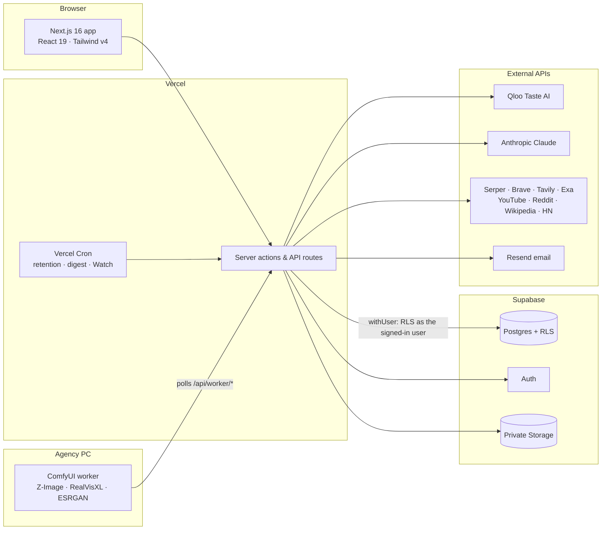

# Architecture



## Code layout

```
src/
  app/(marketing)/   public site: /, /product, /solutions/*, /showcase, /pricing, /about, /privacy, /terms
  app/(auth)/        /login, /signup, /forgot-password  (+ /auth/callback route)
  app/(app)/         authenticated app; layout = floating command bar (no sidebar)
     dashboard, projects, projects/[id]/{brief, research, research/history, evidence/[id], opportunities,
     strategy, strategy/compare, creative-brief, boards, boards/[id], experiments, experiments/[id],
     reports, reports/[id]}, search, tasks, workspace(/clients/[id](/brand, /watch), /activity), settings/*, help
  app/reports/shared/[shareId]   public read-only report (token)
  app/api/           search, research (REST), run polling, PDF export, creative-brief export, account export,
                     notifications, presence, cron/[job], worker/* (GPU worker protocol)
  lib/db             withUser(): every query runs as Postgres role `authenticated` with the verified user id as
                     JWT subject → Row Level Security applies exactly as in Supabase's Data API
  lib/auth           Supabase Auth (production) | local auth (dev/tests only, refused on Vercel production)
  lib/data           data access + server actions per domain; permissions checked with assertCan()
  lib/providers/qloo adapter: client, normalisation, types, demo fixtures
  lib/research       jobs (limits, idempotency), Qloo stage (engine.ts), deep/ = multi-source research:
                     planner, provider registry + adapters, page retrieval, dedupe, claims, quality, budget,
                     cache, orchestrator, synthesis
  lib/ai             LLM adapter (Anthropic, schema-validated), prompts, copilot agent and tools, vision,
                     grounding checks, template engine fallback
  lib/strategy       opportunities, directions (versioned), comparison, Devil's Advocate, creative brief
  lib/boards         inspiration canvas: schema, media processing (sharp), fit checks, critique, layouts
  lib/concepts       image studio: context/provenance, AI art director, story layout, worker protocol
  lib/experiments    experiments, variants, results, statistics
  lib/reports        immutable snapshots, versions, PDF (react-pdf), share tokens
  lib/watch          Watch: daily news monitoring of a client and up to two competitors
supabase/migrations  schema, RLS, functions, buckets (apply in order)
db/local             local-only Supabase shim (roles, auth.users, auth.uid()) for plain Postgres
```

## Authorization

Three layers: (1) the proxy redirects optimistically, (2) server actions call `getCtx()` (verified session
+ DB-checked membership) and `assertCan(role, permission)`, (3) Postgres RLS on every table (members read,
members+ write, admins delete; viewers are read-only). There are also cross-workspace integrity triggers,
an owner guard and immutable report versions. Anonymous visitors can reach exactly one SECURITY DEFINER
function, `get_shared_report(token_hash)`. **The service-role key is not used at all** — including by the
image studio (see `IMAGE_STUDIO.md`).

## AI orchestration

`generateStructured()` calls Claude with zod structured outputs and re-validates before anything is saved.
Evidence ids the model cites are filtered against stored ids, and brief, document and provider text is
wrapped in tags and treated as untrusted. With no `ANTHROPIC_API_KEY`, a deterministic **template engine**
writes drafts only from the brief and stored evidence; they are labelled "Template draft (no LLM
configured)". Workspaces can also switch the LLM off in Settings → Integrations.

The **copilot** (`lib/ai/copilot-agent.ts`) is a multi-step tool-use loop over read-only tools (search
evidence, look up an entity, ask Qloo live, list opportunities, read the strategy, list experiments and
research runs). Each tool runs under the user's RLS and is scoped to the project. Its answer is
schema-validated and cites only evidence ids a tool returned; the lookups it made are shown under each
answer. Any state-changing action is returned as a proposal the user must click to run.

## Research engine

Details in `RESEARCH_ENGINE.md`. A job plans distinct research questions, routes each to the configured
sources that can answer it, retrieves full text for the most relevant pages, deduplicates syndicated
copies, extracts cited claims, follows up on gaps, and stops on coverage, budget, time or diminishing
returns. It then writes a report whose findings cite claims, with contradictions, hypotheses and
limitations. Every call is in the cost ledger; partial results survive provider failures.

The Qloo stage: brief → plan (brand and up to 3 competitors resolved via `/search`, up to 4 audience
interests resolved to tags via `/v2/tags` and sent as `signal.interests.tags`, market as a location
signal, optional age cohort, entity types by category) → `/v2/insights` per type, plus taste tags → every
request logged → entities, relationships and `provider_observation` evidence → interpretation. Runs are
idempotent, rate-limited per workspace per day, execute in the background and are polled by the canvas.

## Inspiration boards and the image studio

Boards are a React Flow canvas (`@xyflow/react`) of image, note, link, Qloo entity, evidence, group and
mockup cards, saved as validated JSON with optimistic concurrency (per-card three-way merge on conflict),
version history, comments, presence, presentation mode with auto-play, and an AI critique. Uploaded
images are re-encoded to WebP without metadata and stored privately. Every image can get a cultural-fit
check (Claude vision against the audience's Qloo taste tags). AI concepts, the worker protocol and the
models are described in `IMAGE_STUDIO.md`.

## Reports

Reports are immutable snapshots tied to the research run and strategy version. New research means a new
version, never a rewrite. Sections include the cultural landscape, evidence, positioning alternatives,
client objections (Devil's Advocate), the visual world, **three visual futures** (AI frames per direction)
and sources. PDF export uses react-pdf with citations and a provider-request appendix. Share links use a
random 256-bit token shown once; only its SHA-256 hash is stored, and links can expire or be revoked.

## Watch

A daily Vercel Cron job (`/api/cron/watch`, 06:00 UTC) checks the news, company newsrooms and YouTube for
a client and up to two competitors, has Claude confirm each story is really about the brand and label it,
and shows share of voice, coverage trends and key developments. "Check now" queues an immediate check.

## Collaboration, notifications, data

- **Presence**: on any campaign page you see who else is there; a field a teammate is editing gets a coral
  outline. Heartbeats every 5 s to `/api/projects/[id]/presence`; the table is under RLS.
- **Notifications**: research finished or failed, a report shared, being added to a workspace; the bell
  polls every 30 s while the tab is visible. Email via Resend when configured.
- **Retention**: owners can set a retention period (30 days to 1 year) for raw provider responses, copilot
  conversations, activity history and finished tasks, and can delete a whole workspace (stored files are
  removed from Storage first).

## Supabase configuration (production)

1. Create a project. Under **Auth → URL configuration**, set the Site URL to `APP_BASE_URL` and add
   `APP_BASE_URL/auth/callback` as a redirect URL. Keep email confirmation on.
2. Apply the migrations in order: `supabase db push`, or
   `DATABASE_URL=<direct connection string> npm run db:migrate`. Do **not** pass `--local`.
3. The migrations create the private buckets (`brief-documents`, `board-media`) and their policies.
4. Turn off the auto-generated REST API: the app talks to Postgres directly, and migration
   `…20261031000100_security_hardening.sql` already makes every Data API request fail; also remove `public`
   under **Settings → API → Exposed schemas**.
