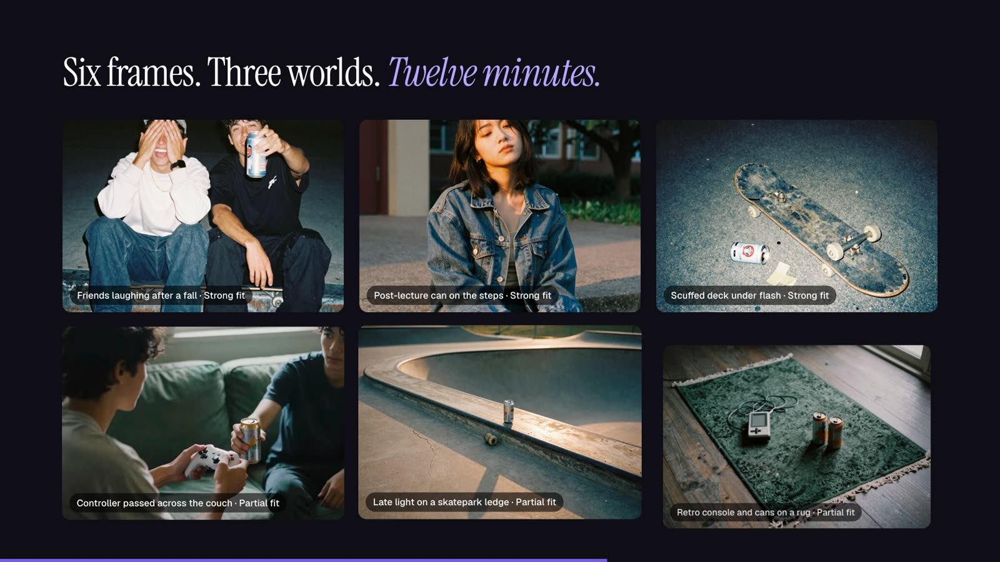
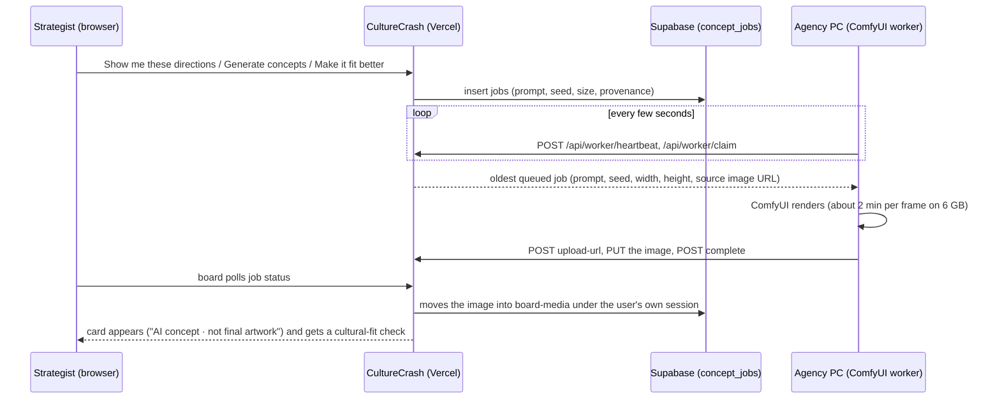

# Image studio: concept frames on your own GPU

CultureCrash turns a strategy direction into concept frames (photographic AI images), copy and touchpoint
mockups. The images are rendered by **ComfyUI on a GPU the agency owns** (tested on an RTX 3050 6 GB laptop),
not by a paid image API: there is no per-image fee and no image leaves the studio.

## How it fits together

- **The PC calls out, nothing calls in.** The worker polls the website, so the PC needs no open port, tunnel
  or static IP. It authenticates with a shared secret, `CC_WORKER_TOKEN`.
- **No service-role key.** The website never holds Supabase's master key: a finished image waits briefly in
  the job row, and the next status check by a workspace member moves it to Storage under that member's
  session.
- **Resilient.** A job whose PC goes quiet for 10 minutes is handed out again (3 attempts); jobs nobody picks
  up within an hour fail with a clear message, so the board never waits forever.

## Worker protocol

All endpoints take `Authorization: Bearer $CC_WORKER_TOKEN`.

| Endpoint | Body → response |
|---|---|
| `POST /api/worker/heartbeat` | `{ worker_id, state, current_job?, comfyui, gpu: { name, vram_total_mb } }` → `{ ok }` |
| `POST /api/worker/claim` | `{ worker_id }` → `{ job: { id, workflow, params } }` or `{ job: null }` |
| `POST /api/worker/jobs/:id/status` | `{ status: "running" \| "error" \| "queued", error? }` |
| `POST /api/worker/jobs/:id/upload-url` | → `{ signed_url, path }` (a per-job URL on this site; max 4 MB) |
| `PUT  <signed_url>` | the PNG/JPEG/WebP body (raw or first file of a multipart form) |
| `POST /api/worker/jobs/:id/complete` | marks the job done once the image has arrived (idempotent) |

`params` for `w1-concept` (text → image): `prompt`, `seed`, `width`, `height`. For `w3-variation`
(image → image): `prompt`, `negative`, `seed`, `denoise`, `image` (a short-lived signed URL of the source).
Sizes stay within **1152 px per side** (the gateway's limit): 1024², 896×1152 (portrait) or 1152×896
(landscape).

## Models (all commercially usable)

| Workflow | Model | Use |
|---|---|---|
| `w1-concept` | **Z-Image Turbo** (fp8 or GGUF) | concept frames, text → image |
| `w3-variation` | **RealVisXL V5** | variations of a frame, image → image |
| `w6-upscale` | **Real-ESRGAN x4** | final 2× upscale |

Not used, for licence reasons: FLUX.1-dev, RMBG-2.0, InstantID, PuLID-FLUX.

ComfyUI workflows follow a title contract so the worker can fill them: `INPUT_prompt`, `INPUT_negative`,
`INPUT_seed`, `INPUT_size` (width and height), `INPUT_image`, `INPUT_denoise`, and a single `OUTPUT`
SaveImage with `filename_prefix: "culturecrash"`. 6 GB settings: `--lowvram --preview-method none`, batch 1,
VAEDecodeTiled (tile 512).

## Setting up the PC

1. Install **ComfyUI** (we use it through **Pinokio**) and the models above.
2. Run the CultureCrash worker on the same PC with `CC_WORKER_TOKEN` and the website address
   (e.g. `https://your-app.vercel.app`).
3. Set the **same** `CC_WORKER_TOKEN` in the website's environment (Vercel → Settings → Environment
   Variables) and redeploy. Without it, the image buttons stay hidden.
4. Open any board: the Generate dialog shows **"GPU PC online · <GPU name>"** once heartbeats arrive.

## What the art director does

With an Anthropic key configured, Claude acts as an art director:

- **Show me these directions** (strategy page): for each direction it picks a distinct photographic look
  (film stock, light, lens), writes a portrait *hero* shot and a landscape *world* shot, and writes a
  headline, a line and a social caption. The board is laid out as a story: who they are → the tension →
  the idea → the world → how it shows up → touchpoints.
- **Why this image**: every frame keeps its provenance (Qloo signals, cited evidence, direction, art
  direction, exact prompt, fit check).
- **Make it fit better**: on a partial or off-taste frame, Claude looks at the image and its fit result,
  names concrete changes and queues a rewritten frame on the same seed, placed beside the original.
- **Mockups**: any frame can be shown as a social post, story, playlist cover or billboard (generic layouts,
  no platform marks), with the "Mockup · AI concept" label.
